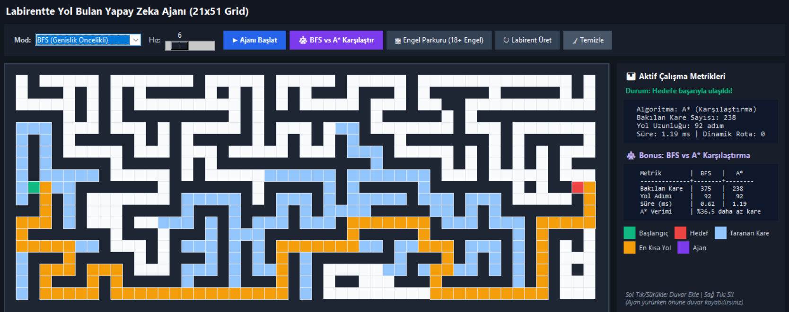

# 🧩 Labirentte Yol Bulan Yapay Zeka Ajanı (Hibrit BFS & A* Karşılaştırması)


Bu proje, **`21 × 51` karelik** etkileşimli bir ızgara (grid) ortamında başlangıç noktasından hedefe en kısa yolu bulan, hareket halindeyken önüne yerleştirilen yeni engelleri anlık algılayıp **hibrit dinamik rota yeniden hesaplaması** yapan ve **BFS ile A\* (A-Star)** algoritmalarının arama verimliliğini canlı olarak karşılaştıran bir yapay zeka yol planlama (pathfinding) simülasyonudur.



---

## 🎯 Temel Özellikler

* **Etkileşimli `21 × 51` Izgara Ortamı:** Başlangıç `(10, 2)` ve hedef `(10, 48)` noktalarının yer aldığı 1.071 hücrelik alan üzerinde kullanıcı fareyle **sol tık / sürükle** yaparak yeni duvarlar ekleyebilir, **sağ tık / sürükle** ile mevcut engelleri kaldırabilir.
* **Garantili Çözülebilir Engel Parkuru ve Labirent Üretimi:**
  * **Engel Parkuru Modu:** Başlangıç ve hedef arasına en az 18–20 adet çok hücreli engel bloğu yerleştirir ve her engelden sonra yolun tamamen kapanmadığını BFS ile doğrular.
  * **Labirent Üretimi (Recursive Backtracker):** Her çalıştırmada alternatif kısa yollar içeren rastgele, çözülebilir labirent haritaları oluşturur.
* **Hibrit Yol Planlama (`BFS + Dinamik Engel Kaçınma`):** Ajan başlangıçta BFS ile en kısa rotayı hesaplar; animasyon sırasında kullanıcı ajanın ilerlediği güzergâh üzerine yeni duvarlar çizerse ajan engeli anında tespit eder ve bulunduğu kareden hedefe yeni en kısa rotayı dinamik olarak üretir.
* **Bonus — BFS ve A\* Algoritma Karşılaştırması:** Tek tıkla aynı harita üzerinde hem **BFS** hem de **Manhattan Sezgisel Fonksiyonlu A\*** çalıştırılarak bakılan kare sayısı, bulunan yol uzunluğu, hesaplama süresi (`ms`) ve A\* algoritmasının sağladığı tarama tasarrufu (`%`) yan yana tabloda raporlanır.
* **Pekiştirmeli Öğrenme Desteği (`Q-Learning`):** Harita bilgisini önceden kullanmadan ödül (`+100`) ve engel cezası (`-5`) mekanizmasıyla 1.400 bölüm (episode) boyunca Q-tablosunu güncelleyerek hedefe ulaşan ek bir öğrenen ajan modu içerir.

---

## 🛠️ Teknoloji Tercihi

Harici bir paket kurulumuna ihtiyaç duymadan yüksek kare hızında adım adım arama animasyonu sunabilmek ve kullanıcının simülasyon sürerken fareyle gerçek zamanlı duvar çizebilmesini sağlamak amacıyla statik çizim kütüphaneleri (`matplotlib`) yerine Python'ın yerleşik **`tkinter` Canvas** grafik motoru tercih edilmiştir.

---

## 🧠 Kullanılan Algoritmalar ve Karşılaştırma Sonuçları

| Algoritma | Çalışma Prensibi | Veri Yapısı / Sezgi | En Kısa Yol Garantisi |
| :--- | :--- | :--- | :---: |
| **Hibrit BFS** | Başlangıçtan itibaren katman katman genişler; hareket sırasında yol kapanırsa anlık yeniden planlama yapar. | Kuyruk (`collections.deque`) | Evet |
| **A\* (A-Star)** | Kat edilen adım maliyeti $g(n)$ ile hedefe olan Manhattan mesafesini $h(n) = \Vert{}x_1 - x_2\Vert{} + \Vert{}y_1 - y_2\Vert{}$ birleştirerek doğrudan hedefe yönelir. | Öncelik Kuyruğu (`heapq`) | Evet (En az taramayla) |
| **Q-Learning** | Deneme-yanılma yoluyla durum-aksiyon değerlerini ($Q(s, a)$) öğrenerek politika oluşturur. | Q-Tablosu (`dict`) | Öğrenme sonrası |

### BFS vs A\* Performans Karşılaştırması (`21 × 51` Labirent Testi)

Ekran görüntüsündeki `21 × 51` labirent haritası üzerinde **BFS** ve **A\*** algoritmaları çalıştırıldığında elde edilen birebir ölçüm sonuçları aşağıdadır:

| Değerlendirme Metriği | BFS (Genişlik Öncelikli) | A\* (A-Star) | Karşılaştırma Analizi |
| :--- | :---: | :---: | :--- |
| **Bakılan (Taranan) Kare Sayısı** | `375 kare` | `238 kare` | **A\* %36.5 daha az kare taradı** |
| **Bulunan Yol Uzunluğu** | `92 adım` | `92 adım` | Her iki algoritma da en kısa rotayı buldu |
| **Hesaplama Süresi** | `0.62 ms` | `1.19 ms` | A\* düğüm sayısını %36.5 azaltırken, küçük ızgarada `heapq` öncelik kuyruğu ve sezgisel mesafe hesabı milisaniye altı sabit ek yük oluşturur |

---

## 📊 Veri Seti ve Ortam Üretimi Hakkında

Bu proje harici bir statik veri seti yerine **prosedürel olarak üretilen dinamik 2B ızgara (grid) ortamları** üzerinde çalışmaktadır:
1. **Çok Engelli Açık Parkur Üretici:** `21 × 51` boyutlu matris üzerinde rastgele konum ve uzunluklarda (`3–5` birimlik) engel blokları yerleştirilir ve BFS doğrulamasıyla çözülebilirlik garanti altına alınır.
2. **Recursive Backtracker Labirent Üretici:** Derinlik öncelikli kazma algoritması ile rastgele koridorlar ve alternatif geçiş noktaları oluşturulur.
3. **Kullanıcı Etkileşimli Harita:** Fare hareketleriyle gerçek zamanlı değiştirilebilen matris yapısı sayesinde sınırsız sayıda özel test senaryosu üretilebilir.

---

## 📁 Proje Dizin Yapısı

```text
labirentte-yol-bulan-ajan/
│
├── proje3.py               # Ana simülasyon, BFS/A*/Q-Learning motoru ve Tkinter arayüzü
├── ekran_goruntusu.png     # Uygulama ve BFS vs A* karşılaştırma ekran görüntüsü
├── requirements.txt        # Bağımlılık açıklaması (harici paket gerektirmez)
├── .gitignore              # Sanal ortam ve önbellek dosyaları hariç tutma listesi
└── README.md               # Proje dokümantasyonu
```

---

## 🚀 Kurulum ve Çalıştırma

### 1. Projeyi Klonlayın ve Klasöre Girin
```bash
git clone [https://github.com/azratashan/yzt-labirentte-yol-bulan-ajan.git](https://github.com/azratashan/yzt-labirentte-yol-bulan-ajan.git)
cd yzt-labirentte-yol-bulan-ajan
```

### 2. Uygulamayı Başlatın
Harici bir paket kurulumuna ihtiyaç duymadan doğrudan Python ile çalıştırabilirsiniz:
```bash
python proje3.py
```

### Kullanım Kontrolleri
* **`▶ Ajanı Başlat`:** Seçili modda (*Hibrit BFS*, *A\**, *BFS* veya *Q-Learning*) arama sürecini ve ajanın hareketini animasyonla başlatır.
* **`⚖️ BFS vs A* Karşılaştır`:** Aynı haritada iki algoritmayı yarıştırıp baktıkları kare sayılarını sağ panelde karşılaştırır.
* **`Sol Tık / Sürükle`:** Haritaya duvar/engel ekler (ajan hareket halindeyken önüne engel koyarak dinamik rota değişimini test edebilirsiniz).
* **`Sağ Tık / Sürükle`:** Haritadaki duvarları siler.

---

## 👤 Yazar ve Katkılar

**Azra Taşhan** — Bursa Uludağ Üniversitesi Bilgisayar Mühendisliği | Yapay Zeka Topluluğu (YZT)  
GitHub: [@azratashan](https://github.com/azratashan)